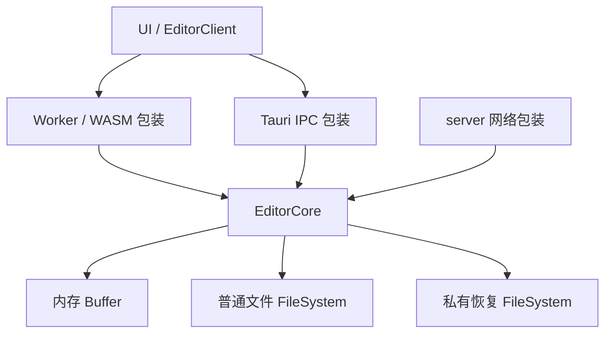
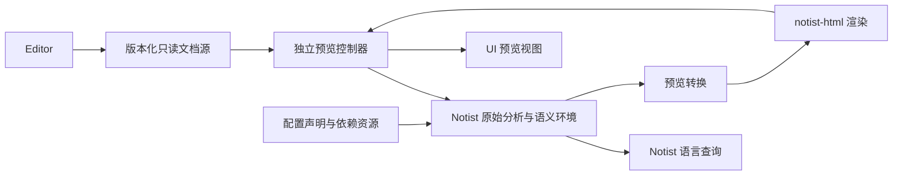

# 架构（手写版，0 AI）

Vault 为会话范围（类似 Zed、VSCode 等编辑器的“打开文件夹”），涉及的实体和操作如下：

- 目录项
  - 读取/创建/删除/修改（重命名/移动）
- Buffer
  - 读/写

其中只有 Buffer 通过 CRDT 数据结构建模与协作，目录项操作用普通 API 加 Host 侧处理。

# Celestite 目标架构

Celestite 使用统一的 Rust EditorCore。拥有文件的实例注入普通文件空间与可选私有恢复空间；加入远端 host 的客户端只持有内存副本。UI 通过同一套命令、查询与事件接口访问它们。实施顺序见 [路线图](roadmap.md)。

## Vault 与 VaultInstance

- **Vault**：逻辑库定义，包含稳定 vaultId，不持有运行资源；historyId 标识一次运行中的协作历史。
- **VaultInstance**：Vault 在本机的实例，拥有一个 EditorCore、可选私有存储和连接配置。
- **EntryId**：文件或目录的稳定身份；移动保留身份，复制创建新身份。
- **文档历史与 writer**：每个已加载文本在内存中独立持有 CRDT 历史；不同实例使用不同 writer 和个人撤销栈，重启重新建立历史身份。

本机存储、普通目录映射和协作连接分别配置。URL 是连接入口，文档路径是可变的文件位置，移动不改变当前历史中的文档身份。Web 默认 Vault 独立存在且不可从列表删除；加入远端 Vault 创建或复用另一实例。

### server 托管边界与远端权限

每个 server 进程只服务一个 Vault，以 `[vault]` 配置目录和权限；客户端可以连接多个独立 server。server 协作状态只驻留内存，普通文件通过保存写回托管目录。集中托管多个 Vault 留待 SaaS 场景再设计。

远端连接使用 `https://host/<key>` 作为基址，接口追加 `/api/v5/...`。每个 Vault 固定提供 readonly / edit 两条链接，由秘密值、Vault 身份和独立权限域派生；readonly 使用 `ro-` 前缀，完整 key 参与凭证查找，URL 不含 Vault 名称或磁盘路径。server 的 Vault 身份由秘密值和规范根目录确定，协作历史身份每次启动重新生成。

配置文件和 CLI 均可省略 `share_key`，由宿主生成仅供本次进程使用的随机秘密值。复用显式秘密值与同一根目录可保留链接；修改秘密值或根目录并重启轮换两种链接。固定链接不提供历史恢复。`public_url` 决定公开基址。宿主启动日志输出完整链接，普通请求与诊断脱敏 key。没有动态分享管理或分享初始化流程。

HTTP、WebSocket 和持续订阅共用授权上下文。readonly 允许读取、预览和实时更新；edit 允许正文与目录修改，仍受 Vault 级只读限制。宿主退出关闭持续连接，客户端保留未确认正文及恢复能力。两种链接分别建立客户端实例与编辑会话，不合并权限；完整链接按凭证保存。core 不处理分享凭证，宿主文件观察与协调独立运行。

## core 与平台边界

图中的 EditorCore 是共同的类型与契约，每个实例各自拥有状态。

EditorCore 与 Buffer 的 API 按 Rust 所有权设计：查询借用 `&self`，修改借用 `&mut self`，所有者决定何时调用和如何串行访问。原生类型不内建消息循环、锁或服务请求分发；是否异步由业务 IO 决定，不由 Worker、IPC 或网络部署方式决定。

外部包装持有 EditorCore，负责参数编解码、坐标与版本编码适配、消息排队及回复和事件交付，在调用期间取得唯一可变访问。包装调用原生方法，不复制保存、恢复、撤销或历史准入规则；DTO、请求标识与 JSON 方法分发不成为 EditorCore 自身的 API。后台工作使用不可变输入与类型化结果，脱离所有者执行后仍由原生完成方法检查结果适用性。

| 层         | 职责                                                                         |
| ---------- | ---------------------------------------------------------------------------- |
| UI         | 渲染、布局、鼠标命中、滚动、IME、文件树交互与待确认输入投影                  |
| EditorCore | 文档集合、Vault 目录与身份、编辑命令、保存与明文恢复、历史导入导出、语言服务 |
| Buffer     | 内存中的单份文本历史、个人撤销、锚点与变更效果                               |
| FileSystem | 字节读写、目录操作、内容 revision 与条件写入；不解释草稿或 CRDT              |
| 协作运行时 | 在线成员、授权会话、文档订阅、host 确认与临时视图状态                        |
| 平台包装   | 创建和承载 core、消息传递、任务执行、进程及连接适配                          |

core 显式接收实例身份，以及彼此独立的普通文件空间和私有恢复空间。宿主保留稳定的 instanceId / vaultId，每次运行分配新的 historyId；文档 ID 由 core 使用 UUID v4 分配，默认时钟为跨平台 epoch 毫秒。FileSystem 不提供身份、熵源、时钟或 CRDT 存储服务；确定性测试可以替换时钟闭包。恢复格式、checkpoint、写回意图和恢复顺序由 core 管理。PeerTransport、LspTransport 独立于文件 IO；WASM 使用异步浏览器 IO。

本地与远端在会话协调处分歧。共用会话负责 core 串行访问、输入基准与变更交付；本地会话负责文件打开、保存、冲突处理及恢复调度，远端会话负责接纳 host 历史、上传操作、等待确认与重连。远端客户端不把 HTTP 文件读取接入自己的 core；文件与目录请求交给 host 的文件服务，由拥有文件的 core 协调驻留正文和外部修改。无文件空间的 core 不安排自动保存，直接保存返回不支持。

Rust FileSystem 是内核的基础 IO 能力；Web 的 VaultBackend 是文件访问与连接生命周期接口，既可承载本地文件能力，也可代理 host API。两者不拥有正文、恢复策略或协作历史，主线程通过统一的文件树代理使用它们。

Git 状态是宿主对工作区仓库的只读观察，不进入 FileSystem、EditorCore、CRDT 或恢复材料。native 与 server 通过独立的 Git 扫描模块调用宿主环境的 `git status`，返回 Vault 相对条目；远端客户端向 host 查询，Web OPFS 与没有 Git 能力的实例不提供该装饰。文件树只消费状态快照，目录状态由后代条目聚合，扫描失败不改变文件或编辑结果。

| 平台        | core 位置           | 普通文件空间            | 私有恢复空间 | UI 通道           |
| ----------- | ------------------- | ----------------------- | ------------ | ----------------- |
| Web 本地    | Worker 内的 WASM    | OPFS 或获授权的本机目录 | OPFS         | Worker 消息       |
| Tauri 本地  | native Rust         | 默认库或本机目录        | 应用私有目录 | IPC               |
| server      | native Rust         | 托管目录                | 无           | 网络 API          |
| 远端 client | WASM 或 native Rust | 无；文件请求交给 host   | 无           | Worker 消息或 IPC |

Tauri 的 WebView 只运行 UI，本机访问 core 使用 IPC。桌面会话与目录监听属于应用内部模块，IPC 适配与业务内核分离；core 的 native 文件能力与预览 package 授权按 feature 和目标平台条件启用。WASM 绑定位于 `celestite-core` 的 feature gate 后。桌面开发与验证见[桌面文档](desktop.md)。

桌面实例将稳定身份、明文草稿、磁盘基线与操作恢复意图保存在应用数据目录，普通文件空间保持独立。私有空间不保存 CRDT 快照、增量、版本向量或撤销栈；重启从文件与恢复材料建立新的历史。进程与实例分别独占私有存储，同一规范目录在进程内复用一个 core。WebView 重建时保留仍存活的本机 core 和个人撤销，撤销旧视图订阅；远端会话随连接结束释放。

桌面 IPC 承载编辑命令与 mutation 回执，前端复用输入投影、网络确认和服务调度。平台间 core 接口使用对象参数与类型化回复，WASM 字符串转换留在绑定适配器；预览执行以异步任务与取消信号为契约，浏览器适配器管理 Worker，桌面适配器直接调用 IPC。关闭先冻结并排空输入、确认本地保存与远端发送屏障，再为本地恢复区完成 checkpoint；全部成功才释放实例与窗口。失败恢复交互并保留 owner。组件资源通过已登记的不可变字节快照提供给 WebView，资源 URL 不授予任意文件系统访问。

本机目录按工作集观察：文件树按展开目录枚举，目录监听由独立后台任务增量注册，不以整库扫描或全部监听就绪作为开库条件。文件 IO 在读取前确认对应目录及祖先的单目录监听，恢复文档和预览依赖共用该边界；普通目录不跟随符号链接，显式 package 能力只观察获准的实际路径。变更提示与窗口聚焦核对合并执行，慢检查不积压编辑队列。目录替换后重建监听，Vault 根被替换时明确报失联，不能将旧根句柄与新路径混用；关闭成功后释放监听任务。

## 编辑与语言服务

每份已加载文本历史在实例中由一个单所有者 Buffer 持有正文、CRDT、因果版本、锚点和个人撤销。EditorCore 拥有 Buffer，以原生方法协调正文修改、恢复 checkpoint 和派生状态；不通过暴露活动 Buffer 的任意可变访问绕过这些业务规则。各修改方法共用同一条验证、修改和效果生成管线，Buffer 不持有 IO、连接或通知队列。外部包装只适配调用与交付，不分别生成增量或维护另一套文本历史。

### Buffer 原生接口

- EditorCore 与 Buffer 的普通修改都作用于唯一可变借用下的当前状态，不要求调用者读取、复制并回传当前版本。消息适配负责明确输入坐标对应的状态；取得可变访问后，在同一调用边界校验或映射再调用原生方法，不能直接给旧坐标填上最新版本。原生后台任务的版本适用性属于任务契约，不是所有修改必带的协议参数。
- Rust 的默认位置是 UTF-8 字节偏移，Anchor 是跨编辑的稳定位置；范围端点在修改前的同一状态中统一解析并检查 Unicode scalar 边界。UI / RPC 的 UTF-16 坐标在适配边界转换，不能将不同单位混用。
- Anchor 的创建明确插入 affinity，求当前位置是坐标转换，不返回另一个混合 Anchor 与绝对位置的领域对象。删除引用后的定位与必要缓存由文本内核处理，不要求调用者维护刷新后的 Anchor。
- writer 默认自动分配；只有副本初始化与确定性测试需要显式指定。Rust 保留原生 peer ID，版本使用限定到同一文档历史的不透明原生值，不公开可编辑的字符串 clock map。协议集中编码版本与历史包，业务调用方不拆解 writer 或版本向量。
- 原生修改返回对应这次接受的效果：显示增量、因果版本与原始历史操作；本地产生与导入的操作明确区分。撤销能力、待依赖状态等查询与 UI 展示回执由 owner 按同一接受时点组合，不强迫普通修改返回完整文档状态。修改来源的开放字符串不进入文本契约。
- 个人撤销与位置转换留在 Buffer；调用方以不透明 tag 关联撤销上下文，文本内核只转换位置并报告 tag 的实际生命周期。显式分组与位置恢复属于可选原生编辑选项，任意 JSON 视图元数据由外部适配或编辑会话管理，不进入普通文本读写路径。
- 范围读取复用 Loro 的文本能力；仅在显式请求 owned 全文快照时物化正文。快照不可变且可共享，不为每次修改构造全文或重建协议版本 map，也不另建一套正文历史。

本地输入与隔离的磁盘历史分支使用同一编辑规则，远端同步导入原始操作，不重放展示差异。导入准备只试算一次，通过准入后在原 Buffer 上应用同一结果；实例或状态改变则重新准备，不能替换活动副本来提交试算。文本接受不依赖 CRDT 持久化；私有明文 checkpoint 失败通过恢复错误报告，编辑仍可继续。

UI 即时显示输入并按回复与事件对账。同一文档的多个视图共享 Buffer，各自拥有编辑会话、选区和命令状态。共享既有历史不替换本机 Buffer 或清空其撤销，新加入的客户端从共同快照构造自己的副本；协作光标通过独立 presence 通道传递。

### Web 所有者与模块边界

Rust 接受的正文、视图的待确认投影和 host 的因果确认是三个不同事实，不能混为一份状态。单文档会话负责接受基线、输入队列、投影和拒绝恢复；工作区只协调文档集合、打开、保存和关闭；协作会话只管理网络确认。Worker 接收预算按传输实例持有，IME 暂存、退订和断线共用同一释放规则。

协议值不依赖 UI、应用设置或文件句柄；文件能力的转发与分发只有一个来源，调用所有者保留锁、提交和确认策略。消息服务和 core 使用独立的独占调用边界，慢 IO 可以让出消息边界，但读取基准、映射和原生接受不能被其他 core 修改插入。

跨 Rust / TypeScript 的序列化事实以 Rust 类型为唯一来源，绑定构建生成声明，不维护手写镜像。相同表示直接复用，原生字节坐标、版本向量与协议表示不同的部分保留薄转换。WASM 计算入口传递普通、可克隆的数据对象，反序列化在函数内部显式报告失败；生成类型不代替业务校验。网络历史包和私有明文恢复格式独立保持，不能为绑定工具改变身份精度、字段缺省或已接受修改的交付规则。

编辑视图只拥有 CodeMirror 视图缓存、排版、焦点和临时交互，设置与页面退出策略由应用组合层传入或处理。标签、状态和源码扩展以小的视图模块组合，不建立第二份文档状态。先保持一个 Web 应用包；只有边界稳定、能够独立验证且有独立消费者时才提取工作区包，不按目录数量增加包或发布层。

协作成员状态独立于文本历史：Vault 的协作运行时管理在线成员；连接维护文档 writer、订阅和发送进度；视图独立报告文档身份与焦点。离开视图、停止正文订阅和卸载 Buffer 分别处理。退订保留本会话 writer 与个人撤销，重新加入同一会话历史不重建 Buffer；新连接以活动订阅的完整目录原子替换客户端会话。core 提供当前正文中按文档历史限定的锚点创建与坐标转换，成员通道校验输入依据并确保接收副本已包含发送端的因果依赖；UI 将转换后的区间映射到待确认投影，再测量实际排版并绘制指针、光标和选区。成员状态允许节流、合并和过期清理，不参与保存与个人撤销。

模式、移动、选区和输入手势属于 UI，由视图端选择显式撤销组 ID，不能按 IO 完成时间分组。Vim 命令与插入会话保持明确的分组，不因输入停顿拆分；core 不解释 Vim 命令名称，UI 不建立第二份撤销历史。编辑、撤销、保存和关闭使用共同契约。Vim 开关沿用全局默认值与 Vault 设置覆盖。

UI / RPC 编辑事务使用修改前正文的 UTF-16 区间，正文统一 LF。文档历史从共同快照加入；导入保留原始 writer，个人撤销只撤销自己的操作。RPC 请求有会话与请求标识，事件有连续序号，缺口通过快照对账。本机文本接受与 host 确认独立推进；同步运行时保留有界发送、接收队列和因果确认点，网络等待不占用客户端 core 的编辑边界。保存等待指定正文版本获 host 确认，连接关闭等待发送队列排空；失败保留未确认正文。

语法高亮与折叠是视图正文的派生展示，包含待确认输入。UI 按文件类型选择 Tree-sitter 语法，在独立 Worker 中增量解析并执行高亮、嵌套语言与折叠 queries；结果按视图正文版本校验，切换语法或销毁视图时释放解析资源。语法资源随前端发布，本地与远端视图共用同一套展示逻辑。

文档显示提供源码、实时渲染、分栏与预览四种独立模式，共用全局显示偏好。实时渲染在同一个 CodeMirror 文本视图中使用语法结构范围绘制标题、强调、行内代码、链接、引用与表格，沿用预览的阅读排版并自动换行，按选区显示相应源码标记与空行；所有编辑继续产生普通文本事务，保存、个人撤销、协作与语言查询使用共同的正文通路。排版不等待预览任务或 host 确认，也不修改文件正文。中文组合输入期间保持装饰稳定，远端光标与选区按当前文本坐标展示；结构过期或语法不完整时显示源码。复杂组件的生成内容继续由预览承载，不通过 HTML 逆向推导编辑。

Notist 文档扩展按宿主能力分层：`replace` 与本地 Code 模块在所有平台生效；`command` 只在暴露真实配置路径的 native 预览和语言服务中启用，Web 宿主明确报告进程扩展不可用。Rust `DocumentExtension` 属于宿主编译期扩展，不从 Vault 动态加载。资源发现与 package 授权不执行扩展命令；native 在执行阶段按真实配置目录运行一次，远端副本沿用浏览器规则。扩展脚本与组件同属受信代码，不构成不受信任扩展的隔离域。

LSP 与预览是文档源的独立只读消费者，不由 Editor 持有分析会话。Editor 提供已接受正文、身份、路径与版本化目录；工作区组合分析服务、平台 IO 和视图。Notist 语言服务与预览共享不可变的项目输入、原始分析结果和语义环境；预览专用转换及 HTML 渲染在共享分析之后分叉。语法来源、声明与引用信息按语言查询需要保留，不能从最终渲染树反推。其他语言服务器共享文档源而非 Notist IR；工作区修改仍通过 Editor 的原生准入。结果按正文、路径、依赖版本和消费者代次校验，不预设增量编译器或跨 Worker 的完整 IR 传输。

Notist 语言服务是无头 LSP JSON-RPC 端点：不依赖 stdio 与事件循环，同一服务实现由平台宿主承载，Web 在独立 Worker 中运行 WASM 绑定，桌面本机会话由 native 托管，远端副本通过 host 的只读资源通道取得依赖。客户端以打开文档的生命周期同步全部正文，包括待确认输入；视图挂卸只附接显示，不结束语言文档。诊断携带正文版本，符号与跳转结果按查询时的正文映射到当前视图；失效结果不覆盖新状态。语言服务故障独立于编辑，重启需重新握手并恢复打开文档，不能阻断编辑或保存。

可编辑文档使用 `file:///vault/<路径>` 逻辑 URI 与 UTF-16 坐标；编译资源使用宿主提供的实际资源根及独立命名空间，多层相对路径和异平台路径不经过虚拟 Vault 根截断。预览和语言分析共用 `ResourceContext`，包含目标正文、路径与打开依赖的不可变快照；资源准入与分析消费同一份 import 图。宿主按请求回填资源，并观察实际读取的库内目录与获准的外部依赖。资源授权不扩大普通文件的编辑范围，外部正文快照不能自行提升读取权限。预览继续只消费 core 已接受正文。

## 文档预览

`.not`、`.md` 与 `.markdown` 通过 Notist 分析为同一份 Item 树，再由 `notist-html` 输出 HTML 片段。预览是正文的派生结果，不写入文档历史，也不触发文件保存。Rust 预览计算模块接收不可变快照，不持有 FileSystem 或另一个 EditorCore。Notist 的 `Vault` 负责配置发现、模块导入与递归依赖、IR 转换、组件注册与渲染语义；Celestite 负责提供编译资源快照、版本失效与交互展示。外部依赖的读取授权使用任务正文及配置、声明快照，与分析器装配同一份依赖图。

### 会话与契约

独立预览控制器按文档维护会话，不拥有 Editor、Buffer 或另一份正文历史；多个视图共享分析结果，各自持有订阅、显示模式和滚动位置。UI 订阅时取得状态快照，之后接收带连续事件序号的更新；取消订阅释放该视图的需求。只有有订阅的文档参与预览调度，最后一个订阅结束或文档离开文档源时释放会话及缓存。Editor 关闭只完成编辑历史，消费者由组合所有者单独释放。

| 契约               | 内容                                                                                                  |
| ------------------ | ----------------------------------------------------------------------------------------------------- |
| UI 订阅 / 取消订阅 | 文档身份、订阅标识；订阅标识绑定 EditorClient 会话                                                    |
| 分析任务           | 不透明任务标识、预览会话代次、文档身份、正文 Version、Vault 内路径、项目代次、LF 正文、未保存资源覆盖 |
| 计算结果           | 原任务标识、HTML、源码映射、组件描述、正文与跨文件诊断，或执行错误                                    |
| 预览状态           | 支持情况、待更新 / 计算中 / 就绪 / 失败、目标任务标识、最后一份已接受结果及其版本                     |

文档源在一个只读边界原子捕获目录和按需正文；元数据同步不物化全文，只有派发任务才读取目标及所需声明快照。任务只使用 Editor 已接受的未保存正文。UI 待确认输入继续即时显示；预览允许短暂滞后，不将待确认正文标为已接受版本。消费者按版本、路径和目录变化使派生结果失效；整批文档源替换即使正文版本相同也撤销旧任务。配置、声明及组件资源的编辑、目录操作和远端文件通知推进项目代次，项目资源的未保存快照优先于已保存文件。

预览控制器保存任务对应的完整上下文，同步最新文档源后按正文版本、路径、配置与会话代次决定是否接受结果，不依赖执行器回传的版本声明，也不对 CRDT Version 作整数大小比较。取消、关闭、重开及执行器重启后的旧结果均丢弃。正文变化时，已显示结果保留并标为待更新；旧结果中的源码诊断定位暂停，直到取得适用于当前正文的结果。

### 调度与执行

首期全量分析、全量生成 HTML。首次订阅立即调度；正文变化以 120 ms 防抖合并，最长合并等待为 500 ms。正在执行的同步分析不假定可以中断；每份文档只保留一份最新待处理快照，不排队处理所有编辑版本。超过合并期限时，执行器一旦空闲即可调度最新快照；这不是分析完成时限。

Web 工作区并列组合文档源、独立预览控制器和资源能力，按需创建分析 Worker；计算不打开 OPFS，也不加入编辑和持久化命令队列。资源准备直接调用 FileSystem 的只读 IO，不复用会保存正文的文件下载入口，也不占用编辑命令队列；Notist 通过资源接口决定需要读取的路径，平台补齐快照后计算。native 使用同一独立控制器承载后台任务。控制器决定任务与结果适用性，平台负责计时、消息传递和任务执行。执行器限制同时执行的任务和缓存总量，预览失败不改变编辑接受结果或令编辑服务下线。

本地与远端 Web 视图共用 EditorClient、预览订阅及分析执行器契约。远端连接在自己的 Worker 中运行客户端 core，以 host 历史建立正文；预览直接消费客户端已接受的正文，WebSocket 会话承载历史同步与保存回执。host 回执只确认会话内的编辑接受，只读权限限制编辑而不取消正文预览。

首期输入上限 5 MiB，单份 HTML 与诊断输出上限 16 MiB，预览控制器输出缓存总量上限 64 MiB。Web 每个实例同时运行一个预览任务，执行超过 30 秒视为失败；这些上限控制资源占用，不承诺任意输入的计算耗时。

分析中的源码错误保留恢复树，HTML 与诊断一并返回。执行器加载失败、崩溃或超时只使预览失败，保留最后一份结果并允许显式重试；重试创建新执行代次，不自动无限重启。目录核对与文件树刷新不触发预览重算；正文、项目内容变化或显式刷新才更新预览，失败后不轮询重试。取消订阅后丢弃晚到结果；关闭实例时终止执行器并释放资源。

### 显示、链接与资源

UI 提供源码、分栏和预览模式；显示模式作为全局持久化偏好，由所有文档与实例共用，不接受 Vault 配置覆盖。各文档分别保留滚动位置；窄屏将分栏显示为单独预览，窗口变化不改写模式偏好。切换模式保留编辑会话与选区，隐藏预览不继续订阅分析。HTML 挂在 ShadowRoot 内，使用预览专用样式和应用主题变量；其作用是样式与元素身份隔离，HTML 的可信边界仍由 renderer 的转义、属性白名单、URL 策略和受信任扩展决定。组件模块属于受信任扩展，与应用处于同一 JavaScript 权限域；桌面上也具有应用的 IPC 能力。不受信任组件需要独立执行域及受限消息协议。

首期整体更新 HTML，保留并按新内容高度约束滚动位置。源码分析、转换与渲染诊断合并展示，按任务原始正文将 UTF-8 字节范围转换为 UTF-16，再用于编辑器定位。配置与声明错误携带自己的路径和源码范围，跳转前校验目标文件仍与诊断快照一致。预览能力按格式判断，独立于文本是否可以只读展示。

预览控制器将链接目标解释为当前文档片段、Vault 内条目或外部 URL。相对路径以任务中的文档目录为基准，规范化后不能越出 Vault；预览容器接管导航，同文档片段在自己的 ShadowRoot 中定位，Vault 内链接通过 EditorClient 打开，外部 URL 使用平台打开能力。浏览器页面 URL 不作为 Vault 相对路径的基准。

Vault 文档路径与编译资源身份分开：依赖路径相对于配置文件解析，可以指向 Vault 外的 package。宿主通过独立的只读通道提供配置声明的 package 的声明文件与组件目录，普通 Vault 文件接口保留自己的路径范围。package 不进入文档文件树、CRDT 历史或保存流程，文档根目录和历史身份不因依赖位置变化而改变。外部 package 的文件通知只使项目预览失效；其诊断源码以只读快照显示。浏览器本机目录允许用户另行选择包含 Vault 的资源授权目录，按两者的相对位置解析依赖；资源权限与 Vault 编辑权限独立，授权记录绑定现有实例。OPFS 实例通过已提供的存储能力解析资源，远端与 native 由各自宿主提供资源通道。

package 组件通过 Notist 提供的运行时注册为 custom element，渲染容器保留 ShadowRoot。组件模块及其相对 JS、WASM 等资源来自同一份 package 快照，由页面作用域的同源虚拟 URL 和 Service Worker 提供；URL 保留资源目录关系并跟随部署 base path。资源服务仅处理预览资源路径。正文与声明变化重新渲染，组件实现变化提示刷新页面；已注册模块及其按需资源随页面存活。

附件通过只读资源查询取得，不复用会隐式保存正文的下载流程。图片等扩展使用结构化资源描述，UI 按需读取并管理 Blob URL；替换、取消订阅和关闭时释放。公式与代码高亮作为独立渲染扩展，扩展输出沿用受信任 HTML 契约。

### 源码映射与交互同步

预览结果携带与 HTML 同次生成的源码映射：输出节点标识、任务正文的 UTF-16 区间和映射粒度。renderer 在实际输出的元素上写入内部标识，源码不能伪造该标识；映射不依赖用户填写的 id，不通过再次解析 HTML 猜测源码位置。透明分组、结构性展开和恢复节点按实际输出记录，空范围或生成内容回退到可定位的父级。

节点标识仅在所属任务内有效，不承担跨版本稳定身份。映射与 HTML 一并接受或拒绝，计入预览容量限制；结果过期或 UI 有待确认输入时暂停定位和同步。计算模块提供源码关系，UI 根据 ShadowRoot 和 CodeMirror 的实际排版取得屏幕坐标；DOM 尺寸与滚动几何不进入 core。

双向定位优先支持标题、段落、列表项、表格行及单元格、代码块。源码点击使预览短暂标示对应内容；预览点击非链接内容选中对应源码。目标已可见时保留视口，屏外目标只滚动到可见位置；长节点以可定位的起点或已可见部分为准，不要求整个选区进入视口。链接保持导航语义，拖选文字不触发定位；分栏定位保留分栏模式，单独预览时可切回源码。连续输入不要求每次移动光标都重新居中预览。

分栏连续滚动以源码映射的内容锚点对齐，并在相邻锚点间插值；不按两侧全文滚动高度的比例换算。点击定位后恢复滚动时，将当前两侧视口加入锚点，连续过渡到内容对齐，避免撤销点击后的视口选择。滚动跟随只移动视口，不修改选区或抢夺焦点。一次用户滚动由一侧驱动，程序产生的跟随滚动不得反向触发同步；新用户操作可以接管驱动侧。布局、宽度、字体或 HTML 变化后重新测量；恢复同步时根据当前视口重新取锚点，不重放旧版本坐标。用户可以关闭连续滚动同步，双向点击定位独立可用。

首版映射以内容范围为准。字符级定位另行保留显示文本到原文的映射，以覆盖转义、实体解码、空白归一化、代码围栏与生成内容；不能将显示字符偏移直接加到 Item 的源码起点。源码映射和滚动同步不依赖增量分析或 DOM 局部更新。

增量分析和 DOM 局部更新分别演进。后续分析会话可以接收编辑并复用旧树，显示层可以匹配节点并复用 DOM；源码偏移和用户填写的 id 不作为自动稳定节点身份。

## 明文恢复与文件保存

CRDT、版本向量、锚点与个人撤销只驻留内存。本地实例的私有恢复空间保存明文草稿、磁盘基线、文本格式及保存和目录操作意图；server host 与远端 client 不建立恢复区。重启从恢复材料与普通文件重建 Buffer，使用新的历史身份与 writer，保留稳定的 instanceId / vaultId。恢复不延续旧协作历史或个人撤销。

接受编辑不等待恢复 IO。core 标记待写后，以首次待写起 500ms 为硬期限合并明文 checkpoint，连续输入不延后该期限；会话合并各文档的到期请求，慢 IO 不重复排队全库写入。保存、移动、删除和关闭强制排空。checkpoint 尝试全部文档与目录意图，单个失败不阻止其他材料写入，完成后清除本轮自动重试期限并报告错误。恢复错误的变化同步到相关文档元数据，保留已接受正文并允许后续编辑；显式 checkpoint 和关闭可以重试，失败不得释放 owner 或声称草稿已恢复到磁盘。普通文件的保存版本、host 的因果确认与恢复区错误分别表达，不公开“CRDT 已持久化版本”。

普通目录在保存时从当前运行内已确认的磁盘历史建立隔离分支，先按行定位变化区域，再在区域内做字符级比较，保留未变化字符的身份。平台在 Vault 锁外执行固定算法；core 按文档身份、路径、磁盘基线和观察序号验证结果，重新核对磁盘后合入最新正文。计算期间允许协作历史推进，每份文档只运行一个任务，后续提示合并为最新观察。

协调待完成或失败时，已接受正文保持可读，客户端显示外部修改尚未同步并暂停自动写回。超出预算拒绝整次观察，不按耗时切换为整行或全文替换；相同失败输入采用有上限的退避重试，磁盘内容变化或显式重试立即重新排队。正常完成后清除协调状态。

保存指定文档与因果版本，回执报告实际写回版本。具备恢复区的实例在条件写盘前先保存可恢复的明文与写回意图，写回后更新磁盘基线并完成 checkpoint；结果不确定时保留意图与证据。移动、删除采用相同的意图边界。独立实例的本地冲突提供覆盖、丢弃、取消；共享历史的保存失败只提供取消与重试，不能通过保存丢弃协作者的修改。

私有空间只有一个写入所有者，多窗口 / 标签访问同一运行时或独占打开。关闭视图保留当前 Buffer 和待确认操作；关闭实例先完成输入屏障及恢复 checkpoint 再释放资源。挂起与关闭准备期间保留后台任务，失败恢复交互及排队任务，成功释放后才丢弃晚到任务。普通文件和私有恢复材料分开，私有数据不出现在文件树中。OPFS watch 可以不发事件，应用内操作由 core 发布领域事件。

浏览器本机目录能力由主线程通过用户操作获取和恢复授权，目录 handle 可持久化并传给编辑 Worker。同一目录关联稳定实例身份，私有恢复材料存于 OPFS；普通文件直接访问所选目录。core 负责磁盘基线与外部协调。浏览器锁只协调遵守协议的同源实例，不承诺与外部程序之间的原子条件写入或目录事务。

## 首期协作：单 host

每个协作 Vault 由一个固定 host 托管，多个 client 连接它。host 管理目录操作、按需加载的共同文本历史和普通文件保存；客户端运行自己的 core，首期只在已验证的在线会话中编辑。每份打开的文本由独立 Buffer 持有 CRDT，本地、host 与 client 共用该模型。

host 的普通文件 IO 使用目录句柄能力。创建排他打开新文件；替换先准备完整字节、保留权限并核对磁盘版本，再发布文件。重命名拒绝覆盖目标，失败如实报告已完成阶段。平台保证和不确定结果通过 FileSystem 返回，core 决定是否接受、保留或重试恢复意图。Vault 内操作串行，跨程序的 revision 检查与最终发布仍可能竞争，不承诺跨程序的目录事务。

可编辑正文以规范化 LF UTF-8 的 5 MiB 为上限，物理文本另容纳 CRLF 与 UTF-8 BOM，最多为该上限的两倍加 3 字节。读取、保存、恢复和外部合并使用同一约束；成功保存的合法正文必须能再次读取并恢复。

| 实例角色 | 普通目录                                          | 保存目标  |
| -------- | ------------------------------------------------- | --------- |
| 独立实例 | OPFS 默认目录、浏览器获授权目录或 native 本机目录 | 本机文件  |
| host     | host 托管目录                                     | host 文件 |
| client   | 无本地目录镜像，仅会话缓存                        | host 文件 |

host 通过配置指定唯一的 Vault，client 通过 URL 加入。目录创建、移动、重命名和删除由 host 在线校验、排序执行。每个 VaultInstance 使用一条 WebSocket 连接，以当前历史中的稳定文档 ID 多路传递 CRDT 增量、目录提示、操作确认、保存命令和心跳；host 在内存接受后向已订阅该 Buffer 的会话确认或推送，普通文件写回独立完成。HTTP 用于 Vault 发现、目录操作、附件与普通文件传输。完整链接赋予权限，HTTP 与 WebSocket 在入口处验证 key；握手核对协议与历史身份。

客户端 UI 输入由本地 core 接受并生成增量；远端更新先由 Worker 中的 core 导入，再将正文变化事件交给 UI。导入保留 writer 和个人撤销；UI 增量更新正文和选区，对待确认输入重新映射，IME 组合输入期间保留本地投影，不直接覆盖编辑器 buffer。host 快照、订阅和补齐屏障在同一串行边界建立；补齐完成后才开放编辑。正文接受、host 确认、恢复错误与文件写回分别报告状态；core 的串行修改边界不等待网络确认，传输层按因果依赖有序发送并使用有界队列。保存等待目标版本的 host 确认，资源读取不占用编辑队列。

连接只建立已验证的会话，不加载全文。打开文本时 host 创建或复用 Buffer，客户端从快照建立副本并订阅更新；客户端接入失败退订，不保留无法释放的订阅。同一历史内重连按 ID 重新打开当前订阅的 Buffer，完成视图登记及启动快照、最终路径和删除状态校验后，原子替换 core 与同步状态。提交前失败保留旧正文、写入身份、撤销、未确认屏障与预览订阅；core 提交成功后即采用新会话，后续维护失败不反转提交。重连快照与同一提交边界的事件序号共同交付 UI，基线之后的正文与元数据通知不能被丢弃或倒序覆盖；其间断线仍保留新快照并显示离线状态。删除记录不占用活动路径，路径复用按文档身份区分。host 重启或 URL 指向的历史改变时拒绝沿用旧会话，用户保留正文后重新打开连接；旧历史不直接导入。

目录元数据与正文加载分开：文件树按需读取，文本仅在打开时建立 CRDT，附件按需取得。文件监听核对已加载 Buffer，未打开文件的目录变化仍可发现。关闭标签停止正文订阅并释放视图与预览需求；同一会话的客户端缓存保留 writer 和个人撤销，释放活动路径占用。重连仅替换活动订阅，丢弃关闭缓存。host Buffer 卸载另行设计，必须保留已接受但未写回的共同正文。

离线不能打开或重新进入远端 Vault，也不能打开新的远端文档；整个 Vault 工作区（文件树与编辑区）显示断线遮罩并禁止交互，提供“尝试重新连接”。连接失败、请求超时或权限失效时暂停新操作，UI 与 core 同时限制编辑。旧会话的迟到回复不改变新会话状态，host 按会话有效性校验尚未提交的操作。

重连相当于重新加入：直接从 host 历史重建活动文档，分配新 writer 并清空个人撤销，不重放旧会话操作。尚有未确认输入时，提供当前正文导出，并由用户明确选择丢弃后重连；提交前失败保留原正文。回执丢失但已提交的修改随 host 历史返回。已明确拒绝且未进入历史的输入保留 UI 正文，提供导出和撤回入口；撤回同时移除依赖它的后续输入，并采用当前已接受的历史。结果未知的输入必须走断线恢复流程，不能当作拒绝直接撤回。首期不提供未确认操作核对、合并或恢复界面。独立 OPFS 实例与 host 自身的本机编辑不受远端 client 在线限制。

远端关闭标签或连接只等待编辑确认并释放视图或会话，不触发普通文件保存；已确认的共享正文保留于 host 进程内存，未确认输入阻止关闭。下载读取普通文件投影，不隐式保存共享历史。

首期每个实例在同一 Vault 上选择独立、host 或 client 角色之一。持久化的离线客户端副本、离线编辑、协作目录镜像、Catalog CRDT 和多跳 P2P 后续分别设计。
